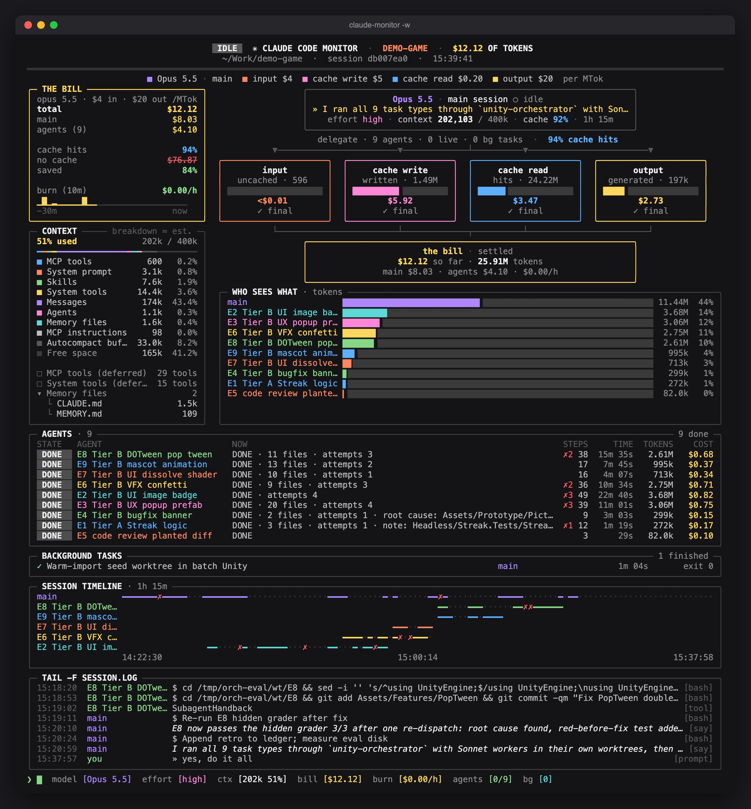

# Claude Monitor

A live dashboard for [Claude Code](https://claude.com/claude-code), built as a Claude Code [mod](https://code.claude.com/docs/en/plugins/mods/overview). It runs inside Claude Code and shows, in a pane beside the chat, what the session costs, how full the context is, and what every subagent and background task is doing.

The same mod works in the Claude Code CLI, the Code tab of the Claude Desktop app, and the VS Code extension. The pane opens by itself when a session starts.



## Core features

- **The bill**: the session's exact cost (the figure `/cost` shows), split into input, cache write, cache read and output, with the share of the main session and each agent, cache savings and a 10-minute burn rate. The split by kind and owner comes from a price table (`PRICES` in `hooks/lib.ts`), scaled to the exact total.
- **Rate limits**: the 5-hour and 7-day windows, as the last API response reported them.
- **Context window**: tokens used against the session's window, broken down as `/context` does (system prompt, tools, MCP tools, skills, agents, memory files, messages, autocompact buffer).
- **Agent team view**: each subagent with its model, state (running, waiting, done, failed, stalled), current tool, steps, time, tokens and cost.
- **Background tasks**: running and finished background shells, monitors and agents.
- **Timeline and log**: per-agent activity lanes and recent prompts, tool calls and replies.
- **Alerts**: stalled agents (no activity for 3 minutes), failed agents or tasks, and context above 80% / 90% of the usable window.

## Requirements

- Claude Code v2.1.287 or later in the terminal, the Desktop app with Claude Code v2.1.286 or later, or the VS Code extension v2.1.299 or later

## Install

From a Claude Code session:

```
/plugin marketplace add cuozg/ClaudeMonitor
/plugin install session-monitor@session-monitor
```

Or load a clone directly in every session (CLI, Desktop and VS Code), by adding it to the `env` block of `~/.claude/settings.json`:

```json
{
  "env": { "CLAUDE_CODE_PLUGIN_DIRS": "~/.claude/monitor" }
}
```

## Usage

- The pane opens when a session starts. In the terminal it docks on the right in [fullscreen rendering](https://code.claude.com/docs/en/fullscreen.md) (`/tui fullscreen`), up to 45% of the width; in a narrower terminal it waits until you open it.
- A one-line band above the prompt shows the cost, context, agents and background tasks, with a **Show monitor / Hide monitor** button (CLI and Desktop; VS Code does not draw this band).
- `/monitor` opens or closes the pane too. A pane you close stays closed for that session until you open it again.
- `Ctrl+X` then an arrow key resizes the pane in the terminal.

## Files

| File | Purpose |
| --- | --- |
| `.claude-plugin/plugin.json` | The mod's manifest |
| `.claude-plugin/marketplace.json` | Lets `/plugin install` find it |
| `hooks/register.tsx` | Records the session from Claude Code's events and opens the pane |
| `hooks/view.tsx` | Draws the dashboard |
| `hooks/lib.ts` | Pricing, formatting and tool labels |
| `types/index.d.ts` | The state the mod keeps |
| `tests/` | `claude plugin test .` |
| `_v1/` | The previous Python + tmux + VSCode-extension monitor, kept as a backup |

## Development

```sh
claude plugin validate .
claude plugin test .
```

## License

[MIT](LICENSE)
